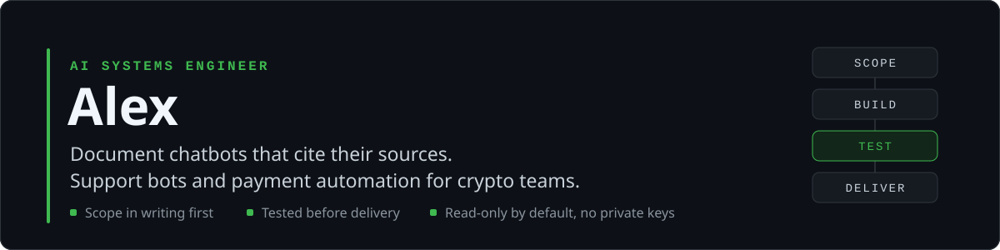
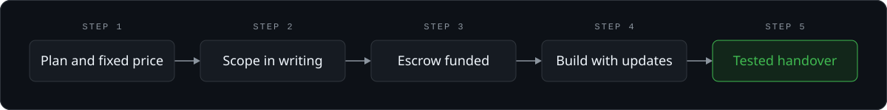

  

I build AI assistants that answer from your documents, support bots for Telegram and Discord communities, and Python automation for crypto and Web3 teams.

My client work is under NDA and stays private. The three repositories below are public demos, built so you can inspect how I work before you hire me.

## What the demos do

  

| Repository | What it does | What you can check |
|---|---|---|
| [rag-chatbot-with-citations](https://github.com/alex-pubgit/rag-chatbot-with-citations) | Answers questions from your documents, cites the source of every answer, and says "I don't know" instead of guessing | 172 tests. Answer quality is measured on a question set, including questions kept out of tuning |
| [telegram-discord-support-bot](https://github.com/alex-pubgit/telegram-discord-support-bot) | Answers community questions, hands off to a moderator when it is not sure, and removes leaked seed phrases | 282 tests. A simulator you can run with no account |
| [stablecoin-payment-watcher](https://github.com/alex-pubgit/stablecoin-payment-watcher) | Confirms from a transaction hash that a USDT or USDC payment really arrived, and alerts on confirmed payments | 85 tests. Run live on three chains. Read-only: it never touches a private key |

Every README has a "Tested and not tested" table. I tell you what I did not verify as plainly as what I did.

## How a project with me runs

  

<table>
<tr>
<th width="50%" align="left">How I work</th>
<th width="50%" align="left">How I keep your project safe</th>
</tr>
<tr>
<td valign="top">

- **Scope in writing first.** You get the deliverables, the deadline and a fixed price before any work starts.
- **Updates every one to two days.** You never have to chase me, and bad news reaches you early.
- **Tested delivery.** Code comes with automated tests, a README and a short "how to check it yourself" note.
- **Fixes included.** Anything that does not match the agreed scope is fixed at no charge.

</td>
<td valign="top">

- I never ask for a seed phrase or a private key, and I do not build anything that needs one.
- I ask for the least access the job needs, and remind you to rotate any API key you shared once the job is done.
- Your code and data stay confidential, with or without an NDA.
- Work starts when escrow is funded and all communication stays on the platform, so both of us have a record.
- No secrets in a repository, ever.

</td>
</tr>
</table>

## What I do not build

Wallet drainers, pump or shill bots, mass-DM and spam tools, account farming, and anything meant to get around a platform's anti-bot or detection systems. I decline those requests.

## Tools I work with

**AI** `RAG` `hybrid retrieval` `evaluation harnesses` `OpenAI-compatible LLMs` `local models` 
**Bots** `Telegram (aiogram)` `Discord (discord.py)` 
**Web3** `EVM JSON-RPC` `ERC-20 / BEP-20 logs` `BNB Chain` `Ethereum` `Polygon` 
**Backend** `Python` `FastAPI` `SQLite` `Docker` `GitHub Actions` 
**Video analytics** `NVIDIA DeepStream` `GStreamer` (client work under NDA, no public demo here yet)

## Working with me

Message me on the freelance platform where you found this profile. Tell me what you need, which data or systems are involved, and your deadline. You get back a plan, the main risk I see, and a fixed price.
